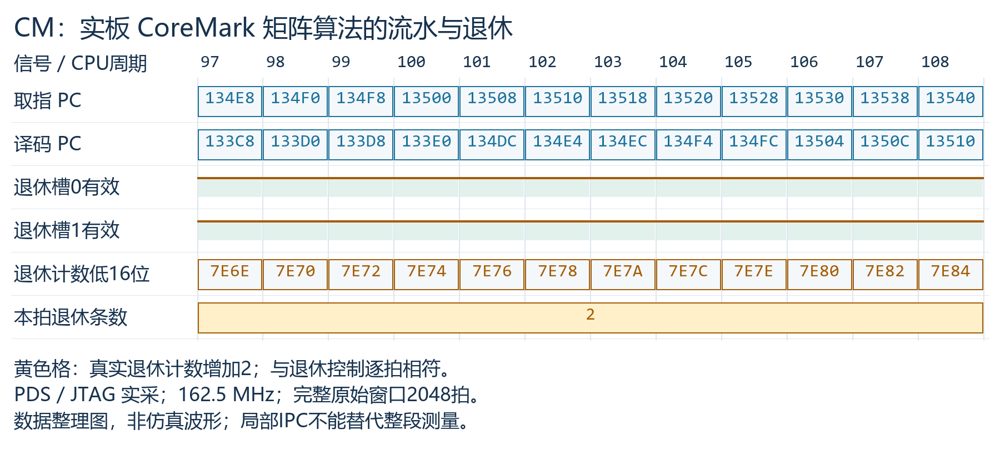
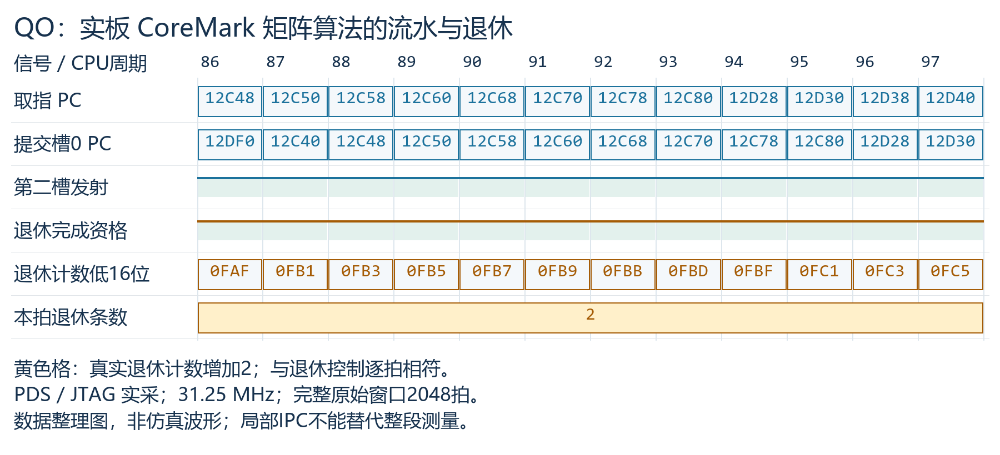
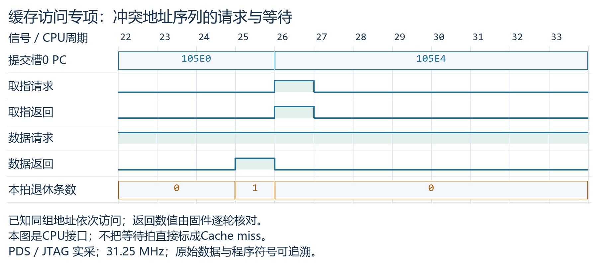
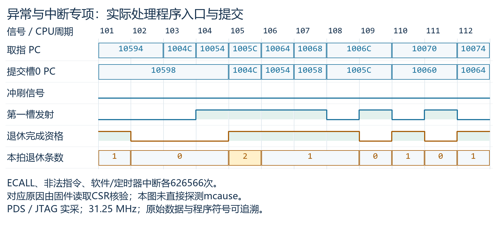
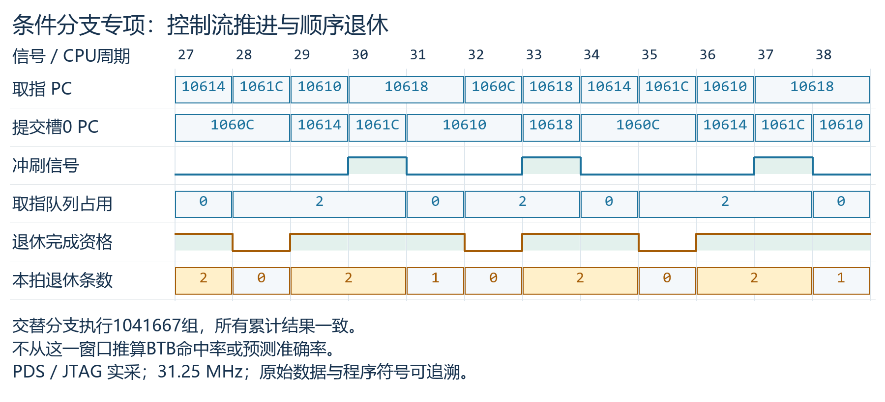
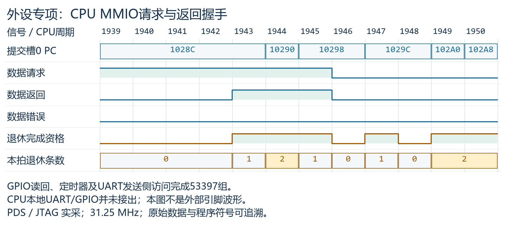
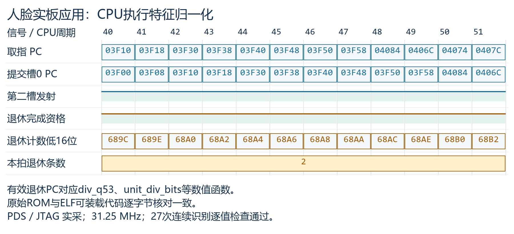
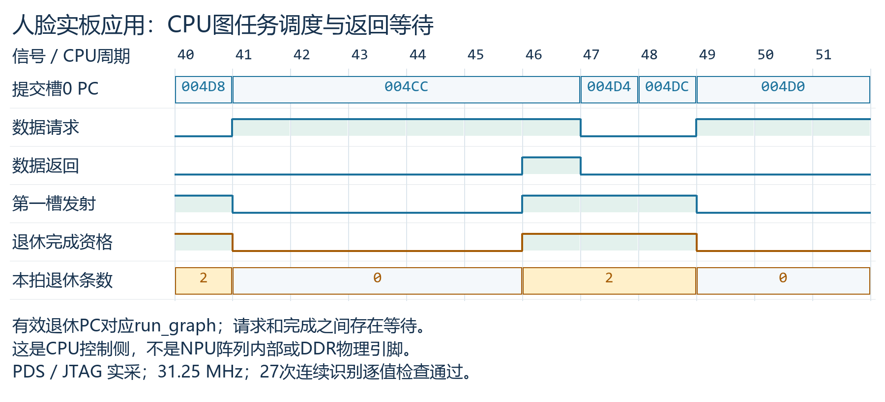

# 实板波形图

原始采样和文件格式见 [README](README.md)。

## CM：CoreMark 流水推进与双退休

采样 97–108；[原始窗口](CM/coremark/window1)。

## QO：CoreMark 双槽发射与退休

采样 86–97；[原始窗口](QO/coremark/window0)。

## 缓存冲突访问

采样 22–33；[原始窗口](QO/diagnostics/test1/window0)。

## 异常与中断处理

采样 101–112；[原始窗口](QO/diagnostics/test2/window0)。

## 条件分支与队列控制

采样 27–38；[原始窗口](QO/diagnostics/test3/window0)。

## 外设 MMIO 访问

采样 1939–1950；[原始窗口](QO/diagnostics/test4/window0)。

## 人脸应用：特征归一化

采样 40–51；[原始窗口](QO/face/window1)。

## 人脸应用：模型调度

采样 40–51；[原始窗口](QO/face/window2)。

