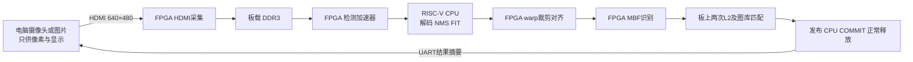

# RISC-V + FPGA 人脸识别演示（已上板 QG）

基于紫光同创 **PG2L200H-6FBB676** 的 RISC-V CPU + 固定模型硬件加速项目。
本仓库整理的是已在 **200K MINI** 实板运行的人脸识别系列：**QB 功能源码 + QG 两网络局部布线修复**。
不是后续未上板的 PX/QI/QK 实验，也不包含未采用的 QG RTL 流水候选。

**当前为实验性源码发布：实板功能通过，但尚未完全闭合 STA。**
慢角 setup 最差 −0.143 ns / 4 个端点；hold 最差 −0.012 ns（慢角）、−0.001 ns（快角，同一端点）。
不要将室温演示成功解释为全温压范围合格。

## 实现了什么

- 原双取指 / 双退休 RV32IM CPU；同一 CPU 可切换 CoreMark，再返回人脸应用。
- RetinaFace MobileNet0.25（640×480）检测和 w600k_mbf（112×112）识别。
- 保留 INT8 / INT12、Q16、舍入和饱和语义；特征处理使用固定数值实现。
- HDMI 输入、DDR3 存储、DMA、CPU NMS/FIT、硬件对齐、图库匹配、结果提交与释放。
- UART 控制台、摄像头图像源、人员登记、温度状态与保护。
- CPU 31.25 MHz，NPU / UI 125 MHz；管理 / ADC 时钟 27 MHz。



**推理计算在 FPGA 内完成。** 主机运行图像准备、传输、控制和显示程序；它不运行人脸检测或身份识别网络。
离线单元测试中有明确的假板对象，那不是实板推理结果。

## 已有证据及边界

| 类别 | 已记录结果 | 不能据此声称 |
|---|---|---|
| 完整应用 RTL | 5 张图像 → 3 次短 CoreMark → 返回人脸通过 | 连续 15D+8R 达标 |
| 实板逐值对照 | 12 次人脸任务；固定输入结果、512 维特征及 Q16 对照通过 | 统计识别准确率 |
| HDMI 演示 | 两图 24 帧：约 3.154 FPS；摄像头 61 帧：约 3.143 FPS | 每帧无抖动或高负载长期可靠性 |
| 同 CPU CoreMark | 2500 次，6.435974 CoreMark/MHz，201.1242 CoreMark/s，12.43013 s，CRC 通过 | EEMBC 官方登记成绩或比赛工具链认可 |
| 物理实现 | QB 布通，QG 仅修复两网络；残余 STA 见上 | 正式时序闭合 |

本次打包不重新进行板测、PNR 或完整长仿真。新打包检查见 [VALIDATION.md](docs/VALIDATION.md)，历史证据摘要见 [EVIDENCE.md](docs/EVIDENCE.md)。

## 目录

| 目录 | 内容 |
|---|---|
| `hardware/` | 实际 QB CPU、加速器、供数、结果、协议、温度、HDMI RTL，板级约束和源文件清单 |
| `firmware/` | 实际 CPU 人脸应用、数值代码、启动汇编、链接脚本、CoreMark 移植层和编译参数 |
| `host/` | QG38 控制台、摄像头 / 图片源、串口协议和主机测试；仅做路径移植 |
| `tests/` | 两项实际模块 RTL 短测、完整应用驱动源码（后者需要外部测试资产） |
| `scripts/` | 完整性、外部依赖、ROM 构建、PDS 综合/映射入口、短测 |
| `reference/` | 原物理布局/布线及 QG ECO 配方、原实验启动器，仅供审查参考 |
| `docs/` | 版本对应、哈希、构建、依赖和证据边界 |

## 详细使用指南

从下载、环境安装、依赖导入、固件构建到 PDS 与板端演示顺序，见 [QG 使用指南](docs/USER_GUIDE.md)。逐项缺件见 [依赖表](docs/DEPENDENCY_TABLE.md)。指南明确区分当前可执行入口与尚需补齐的实板交付步骤。

## 快速检查（无需板子或 PDS）

```powershell
python scripts/verify_release.py
python scripts/check_dependencies.py
```

第二条在干净克隆中会**明确报告外部依赖缺失并返回非零**，这是预期行为。
本仓库不是无需依赖即可重新生成实板位流的整包：

1. 盘古 DDR PHY / 控制器及原语库按厂商许可另行获取。
2. 模型权重 / 派生包未上传；必须匹配 `docs/model_contracts.json`，不能随意替换 ONNX 后宣称等价。
3. HDMI 初始化表、固定版本 CoreMark 上游文件和精确 libgcc 依赖见 `docs/external_files.json`。
4. 私人图库、摄像头照片、串口原始数据、机器凭据、许可证和历史大数据库均未上传。

构建步骤见 [BUILD.md](docs/BUILD.md)，控制台使用及当前移植限制见 [HOST.md](docs/HOST.md)。
仓库未包含可下载位流；已验证位流身份和不可复现边界见 [release_identity.json](docs/release_identity.json)。

## 许可与贡献

项目自有代码采用 [MIT](LICENSE)。第三方依赖不因本仓库采用 MIT 而改变许可；见 [THIRD_PARTY.md](docs/THIRD_PARTY.md)。
代码经历本项目团队多轮开发与整合，包含对队友 C3–C26 系列有效改进的吸收；不宣称全部由某一个作者或工具独立完成。
贡献请说明功能、数值、时序与实板证据分别达到什么程度；勿上传人脸数据、商业工具文件或凭据。

English: This is a source release of a board-tested experimental RISC-V/FPGA face-recognition system. Third-party IP and model payloads are external. Timing is **not fully closed**. See the documentation before attempting hardware reproduction.
